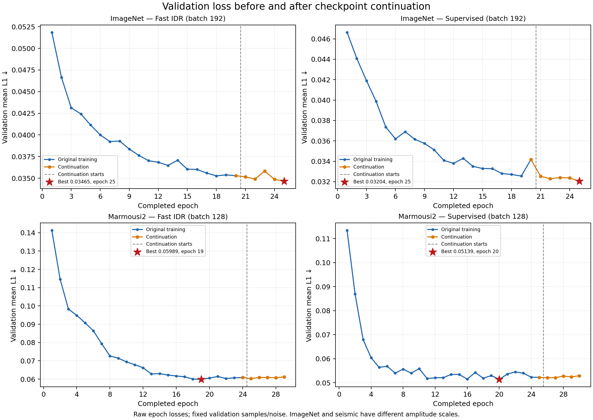
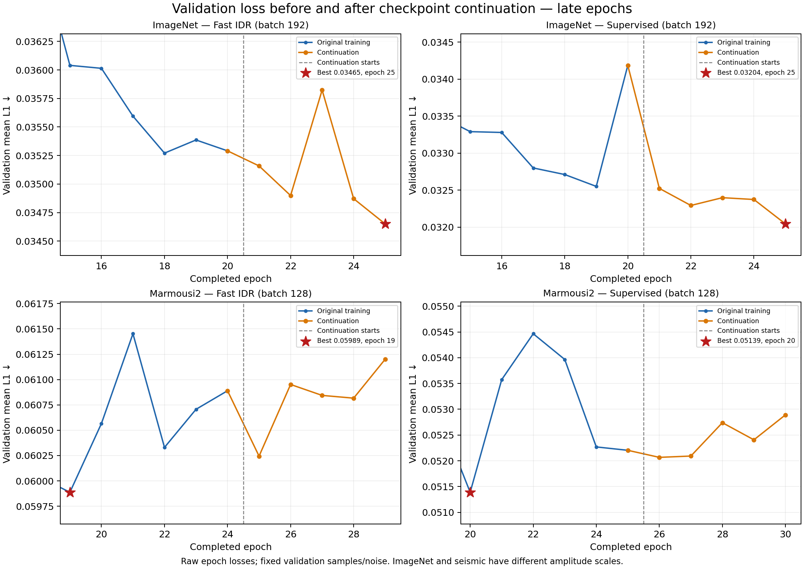

# Continuation results: four requested models

Generated: 2026-11-18T14:52:22+05:30

ImageNet batch 192 and Marmousi2 batch 128; Fast IDR and supervised for each.
Continued from latest full checkpoints for up to five additional epochs, with unchanged batch/data and LR 7.5e-5.
Fresh early-stopping patience; original best models retained unless validation improved.

| Model | Previous best L1 | Best after continuation | Improvement | Best epoch | Last epoch |
|---|---:|---:|---:|---:|---:|
| ImageNet — Fast IDR (batch 192) | 0.035271 | 0.034650 | 1.76% | 25 | 25 |
| ImageNet — Supervised (batch 192) | 0.032551 | 0.032045 | 1.56% | 25 | 25 |
| Marmousi2 — Fast IDR (batch 128) | 0.059887 | 0.059887 | 0.00% | 19 | 29 |
| Marmousi2 — Supervised (batch 128) | 0.051388 | 0.051388 | 0.00% | 20 | 30 |

Lower validation L1 is better. Best-after values include the original best; improvements are descriptive, not statistical significance.





[Full-history PDF](reports/continuation_curves/four_models_full_history.pdf) · [Raw CSV](reports/continuation_curves/validation_losses.csv)

## Final evaluation

These scores do not influence checkpoint selection.

### ImageNet — Fast IDR (batch 192)

Best epoch: 25; completed epoch: 25; early stopped: False.

```json
[
  {
    "dataset": "kodak",
    "sigma": 25,
    "psnr": 30.523456394122217,
    "ssim": 0.8487957546032513
  },
  {
    "dataset": "kodak",
    "sigma": 50,
    "psnr": 27.893152473647913,
    "ssim": 0.7580617868670226
  },
  {
    "dataset": "BSDS300",
    "sigma": 25,
    "psnr": 29.981332937270647,
    "ssim": 0.8538356604882105
  },
  {
    "dataset": "BSDS300",
    "sigma": 50,
    "psnr": 27.252137109979376,
    "ssim": 0.7592347536925232
  }
]
```

### ImageNet — Supervised (batch 192)

Best epoch: 25; completed epoch: 25; early stopped: False.

```json
[
  {
    "dataset": "kodak",
    "sigma": 25,
    "psnr": 31.098017015444583,
    "ssim": 0.8594661180587678
  },
  {
    "dataset": "kodak",
    "sigma": 50,
    "psnr": 27.957063184257823,
    "ssim": 0.7554567016747148
  },
  {
    "dataset": "BSDS300",
    "sigma": 25,
    "psnr": 30.523604742234415,
    "ssim": 0.8697384919865013
  },
  {
    "dataset": "BSDS300",
    "sigma": 50,
    "psnr": 27.273353364331204,
    "ssim": 0.7594093328578402
  }
]
```

### Marmousi2 — Fast IDR (batch 128)

Best epoch: 19; completed epoch: 29; early stopped: True.

```json
[
  {
    "sigma": 0.1,
    "tiles": 21,
    "signal_tiles": 7,
    "input_snr_db": 11.753792241484815,
    "output_snr_db": 17.67488936569435,
    "snr_gain_db": 5.921097124209537,
    "rmse_normalized": 0.019637818536708488,
    "rmse_original_amplitude": 1.8038327865087785e-06,
    "signal_correlation": 0.979950148642767,
    "residual_signal_correlation": 0.10937837423502247
  },
  {
    "sigma": 0.2,
    "tiles": 21,
    "signal_tiles": 7,
    "input_snr_db": 5.733192324622567,
    "output_snr_db": 15.156289255873043,
    "snr_gain_db": 9.423096931250475,
    "rmse_normalized": 0.02461501455435642,
    "rmse_original_amplitude": 2.2610133712428646e-06,
    "signal_correlation": 0.9617509905060867,
    "residual_signal_correlation": 0.09675245819941194
  },
  {
    "sigma": 0.4,
    "tiles": 21,
    "signal_tiles": 7,
    "input_snr_db": -0.28740759355199536,
    "output_snr_db": 12.428734044857018,
    "snr_gain_db": 12.716141638409011,
    "rmse_normalized": 0.03256558396419781,
    "rmse_original_amplitude": 2.9913133150007435e-06,
    "signal_correlation": 0.9215592635708142,
    "residual_signal_correlation": 0.0858483540559261
  }
]
```

### Marmousi2 — Supervised (batch 128)

Best epoch: 20; completed epoch: 30; early stopped: True.

```json
[
  {
    "sigma": 0.1,
    "tiles": 21,
    "signal_tiles": 7,
    "input_snr_db": 11.753792241484815,
    "output_snr_db": 19.070156265504504,
    "snr_gain_db": 7.316364024019693,
    "rmse_normalized": 0.015068692481412436,
    "rmse_original_amplitude": 1.3841354882152793e-06,
    "signal_correlation": 0.9827854136463038,
    "residual_signal_correlation": 0.04983304507925555
  },
  {
    "sigma": 0.2,
    "tiles": 21,
    "signal_tiles": 7,
    "input_snr_db": 5.733192324622567,
    "output_snr_db": 16.266130285443428,
    "snr_gain_db": 10.532937960820856,
    "rmse_normalized": 0.02033519914166118,
    "rmse_original_amplitude": 1.8678907162394928e-06,
    "signal_correlation": 0.964758418077366,
    "residual_signal_correlation": 0.048369123935855726
  },
  {
    "sigma": 0.4,
    "tiles": 21,
    "signal_tiles": 7,
    "input_snr_db": -0.28740759355199536,
    "output_snr_db": 13.330338814819898,
    "snr_gain_db": 13.61774640837189,
    "rmse_normalized": 0.028428488791321548,
    "rmse_original_amplitude": 2.611300234637886e-06,
    "signal_correlation": 0.9266242164273395,
    "residual_signal_correlation": 0.054281122227004173
  }
]
```
