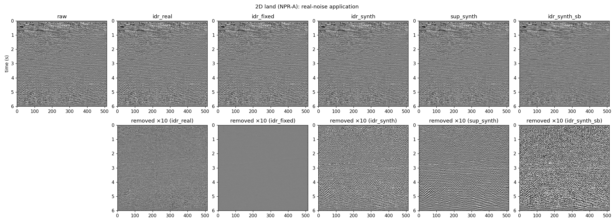
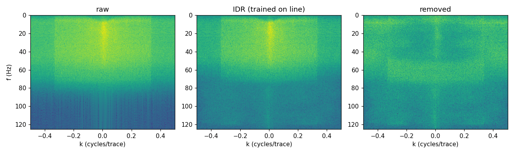
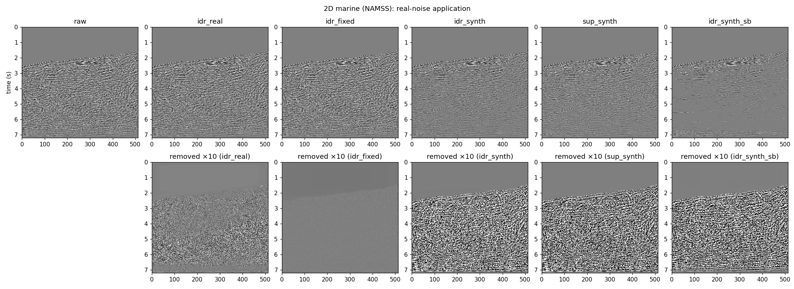
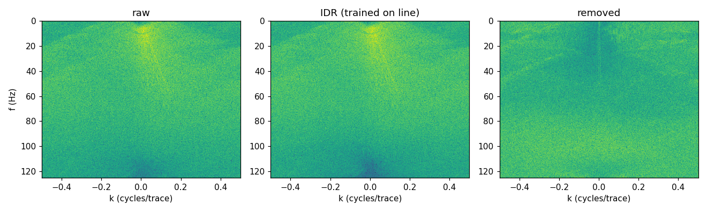

# New results (27 Nov 2026): per-dataset synthetic models and 2-D field lines

Generated by `kgl/new_tables.py`. Trained on Kaggle T4 GPUs (FP32), protocol P (50k steps, batch 4, 256² crops). SNR in dB, mean over sections × 3 test-noise seeds. "—" = not available.

## 1. One model per synthetic dataset vs the joint model (own test set)

| Test | noise | σ / p | per-dataset IDR | per-dataset Sup | joint IDR | joint Sup | input SNR |
|---|---|---|---|---|---|---|---|
| Marmousi2 | sg | 0.5 | 19.47 | 18.17 | 19.31 | 19.34 | 5.98 |
| Marmousi2 | sg | 1.0 | 16.67 | 16.18 | 16.36 | 16.56 | -0.04 |
| Marmousi2 | sb | 0.5 | 18.82 | 17.40 | 19.13 | 18.78 | 5.97 |
| Marmousi2 | sb | 1.0 | 15.89 | 15.52 | 15.96 | 16.09 | -0.04 |
| Marmousi2 | ss | 0.05 | 17.87 | 22.49 | 18.24 | 21.70 | -1.51 |
| Marmousi2 | ss | 0.1 | 15.02 | 19.72 | 15.39 | 18.61 | -4.51 |
| Overthrust | sg | 0.5 | 19.57 | 20.23 | 19.00 | 19.95 | 5.99 |
| Overthrust | sg | 1.0 | 15.92 | 16.30 | 15.35 | 15.95 | -0.03 |
| Overthrust | sb | 0.5 | 17.56 | 18.16 | 17.26 | 18.06 | 5.99 |
| Overthrust | sb | 1.0 | 14.02 | 14.28 | 13.62 | 14.02 | -0.03 |
| Overthrust | ss | 0.05 | 31.57 | 34.83 | 30.65 | 35.07 | -1.50 |
| Overthrust | ss | 0.1 | 27.99 | 31.41 | 26.85 | 31.13 | -4.50 |
| Salt | sg | 0.5 | 23.39 | 24.19 | 23.21 | 24.14 | 6.01 |
| Salt | sg | 1.0 | 20.74 | 21.53 | 20.20 | 21.18 | -0.01 |
| Salt | sb | 0.5 | 22.38 | 22.87 | 22.30 | 23.51 | 6.01 |
| Salt | sb | 1.0 | 19.18 | 19.86 | 18.70 | 19.67 | -0.01 |
| Salt | ss | 0.05 | 24.53 | 26.12 | 24.34 | 27.82 | -1.47 |
| Salt | ss | 0.1 | 21.45 | 25.07 | 21.51 | 25.87 | -4.48 |

## 2a. Transfer: train on one dataset, test on all (sg, σ = 0.5), IDR / Sup

| Trained on ↓ / tested on → | Marmousi2 | M2 PreSTM | M2 PostSTM | M2 SRME | Overthrust | Salt |
|---|---|---|---|---|---|---|
| Marmousi2 | 19.47 / 18.17 | 16.53 / 12.38 | 16.13 / 11.93 | 18.19 / 14.91 | 3.62 / 3.25 | 5.15 / 4.67 |
| Overthrust | 4.44 / 4.52 | 10.77 / 8.19 | 10.82 / 8.33 | 11.26 / 7.77 | 19.57 / 20.23 | 17.73 / 17.78 |
| Salt | 5.07 / 6.34 | 7.42 / 6.81 | 7.48 / 6.73 | 7.76 / 7.01 | 14.00 / 12.83 | 23.39 / 24.19 |
| joint (all three) | 19.31 / 19.34 | 17.37 / 15.75 | 17.08 / 15.43 | 18.56 / 17.73 | 19.00 / 19.95 | 23.21 / 24.14 |

## 2b. Transfer: train on one dataset, test on all (sb, σ = 0.5), IDR / Sup

| Trained on ↓ / tested on → | Marmousi2 | M2 PreSTM | M2 PostSTM | M2 SRME | Overthrust | Salt |
|---|---|---|---|---|---|---|
| Marmousi2 | 18.82 / 17.40 | 14.37 / 10.90 | 14.14 / 10.52 | 16.87 / 13.72 | 2.31 / 1.45 | 3.80 / 2.06 |
| Overthrust | 2.10 / 2.21 | 10.62 / 6.47 | 11.08 / 6.69 | 11.60 / 5.34 | 17.56 / 18.16 | 15.46 / 16.07 |
| Salt | 3.39 / 5.47 | 5.99 / 7.71 | 6.07 / 7.80 | 6.85 / 8.80 | 12.34 / 10.73 | 22.38 / 22.87 |
| joint (all three) | 19.13 / 18.78 | 16.13 / 14.43 | 15.82 / 14.37 | 17.84 / 16.99 | 17.26 / 18.06 | 22.30 / 23.51 |

## 3. 2-D field lines, semi-synthetic test (white noise added; original line = reference)

| Model | 2D land (NPR-A) σ0.5 | 2D land (NPR-A) σ1.0 | 2D marine (NAMSS) σ0.5 | 2D marine (NAMSS) σ1.0 |
|---|---|---|---|---|
| IDR trained on the line (fixed noisy copy) | 11.51 | 8.48 | 8.53 | 5.15 |
| IDR, joint synthetic corpus | 9.25 | 6.27 | 2.94 | 1.96 |
| Supervised, joint synthetic corpus | 9.63 | 6.25 | 3.31 | 2.09 |
| f-x deconvolution | 8.53 | 5.92 | 3.95 | 2.76 |
| bandpass 5–60 Hz | 9.38 | 3.42 | 5.85 | 1.58 |
| input SNR | 6.01 | -0.02 | 4.93 | -1.09 |

## 4. Real field noise (no reference): energy removed and signal leakage

| Field data | model | % energy removed | % removed in 5–60 Hz | % removed outside band | leakage |LS| |
|---|---|---|---|---|---|
| 2D land (NPR-A) | idr_real | 0.15 | 0.12 | 6.59 | 0.118 |
| 2D land (NPR-A) | idr_fixed | 0.00 | 0.00 | 0.26 | 0.163 |
| 2D land (NPR-A) | idr_synth | 1.44 | 1.30 | 28.60 | 0.373 |
| 2D land (NPR-A) | sup_synth | 0.97 | 0.88 | 18.84 | 0.370 |
| 2D land (NPR-A) | idr_synth_sb | 11.28 | 10.84 | 104.51 | 0.305 |
| 2D marine (NAMSS) | idr_real | 1.44 | 0.46 | 4.74 | 0.320 |
| 2D marine (NAMSS) | idr_fixed | 0.04 | 0.01 | 0.13 | 0.300 |
| 2D marine (NAMSS) | idr_synth | 40.34 | 27.59 | 83.62 | 0.284 |
| 2D marine (NAMSS) | sup_synth | 33.97 | 20.53 | 79.46 | 0.290 |
| 2D marine (NAMSS) | idr_synth_sb | 63.56 | 56.54 | 87.36 | 0.305 |
| F3 | idr_real | 0.02 | 0.01 | 0.18 | 0.124 |
| F3 | idr_synth | 1.09 | 0.75 | 4.64 | 0.311 |
| F3 | sup_synth | 1.52 | 0.80 | 8.80 | 0.263 |
| F3 | idr_fixed_f3 | 0.01 | 0.01 | 0.05 | 0.168 |
| Stratton | idr_real | 0.04 | 0.01 | 0.18 | 0.054 |
| Stratton | idr_synth | 0.90 | 0.75 | 1.64 | 0.361 |
| Stratton | sup_synth | 0.73 | 0.79 | 0.57 | 0.338 |
| Stratton | idr_fixed_st | 0.03 | 0.01 | 0.09 | 0.511 |

