# Results dump: paper-protocol Fast IDR reproduction + seismic adaptation

_Queue status at build time: 103/104 jobs done; running: report_seeds; failed: none._

## 1. Image reproduction (protocol P)

PSNR (dB) / SSIM, final 50k-step checkpoints. Seeds are mean ± sd over training seeds 0–2. Paper columns from Table 2 are copied; "ours" columns are measured.

| set | BM3D paper | BM3D ours | Nr2N paper | Nr2N ours (2f(z)−z, K=1) | Nr2N ours (K=8 avg) | IDR stage-0 net applied to y | N2N paper | N2N ours | Sup paper | Sup ours (n=3) | IDR paper | IDR ours (n=3) | IDR fixed-noise ours | IDR FP32 ours | MPRNet paper |
|---|---|---|---|---|---|---|---|---|---|---|---|---|---|---|---|
| kodak σ=25 | 31.88/0.869 | 31.90/0.870 | 31.96/0.869 | 29.60/0.813 | 31.01/0.847 | 25.00/0.528 | 32.39/0.886 | 32.02/0.878 | 32.39/0.885 | 32.09±0.01 | 32.36/0.884 | 31.91±0.01 | 31.87/0.875 | 31.85/0.876 | 32.85/0.893 |
| kodak σ=50 | 28.64/0.772 | 28.69/0.777 | 28.73/0.770 | 26.49/0.677 | 27.75/0.737 | 19.76/0.295 | 29.23/0.803 | 28.81/0.787 | 29.24/0.803 | 28.91±0.01 | 29.27/0.803 | 28.73±0.01 | 28.66/0.781 | 28.73/0.785 | 29.78/0.817 |
| BSDS300 σ=25 | 30.47/0.863 | 31.04/0.876 | 29.57/0.815 | 28.82/0.819 | 30.31/0.855 | 24.81/0.577 | 31.39/0.889 | 31.26/0.886 | 31.40/0.889 | 31.30±0.01 | 31.48/0.890 | 31.16±0.00 | 31.12/0.882 | 31.14/0.884 | 31.87/0.897 |
| BSDS300 σ=50 | 27.14/0.745 | 27.69/0.772 | 26.18/0.684 | 25.74/0.678 | 26.99/0.736 | 19.70/0.345 | 28.17/0.799 | 27.94/0.789 | 28.17/0.799 | 28.01±0.01 | 28.25/0.802 | 27.87±0.01 | 27.82/0.783 | 27.87/0.786 | 28.65/0.814 |
| BSD68 σ=25 | 28.55/0.782 | 28.60/0.808 | NA | — | — | — | 29.15/0.831 | — | 29.20/0.835 | 29.04/0.825 | 29.20/0.835 | 28.84/0.822 | — | — | 29.40/0.840 |
| BSD68 σ=50 | 25.59/0.670 | 25.67/0.689 | NA | — | — | — | 26.23/0.725 | — | 26.24/0.727 | 26.11/0.714 | 26.25/0.726 | 25.95/0.709 | — | — | 26.48/0.736 |

**Gap to paper (ours − paper, PSNR dB) and IDR − Sup within each study:**

| set | IDR ours−paper | Sup ours−paper | paper IDR−Sup | ours IDR−Sup |
|---|---|---|---|---|
| kodak σ=25 | -0.45 | -0.30 | -0.03 | -0.18 |
| kodak σ=50 | -0.54 | -0.33 | +0.03 | -0.18 |
| BSDS300 σ=25 | -0.32 | -0.10 | +0.08 | -0.14 |
| BSDS300 σ=50 | -0.38 | -0.16 | +0.08 | -0.14 |

**Table 5 analogue (binomial / impulse, p = 0.5).** Paper column order N2N/Sup/Ours as printed; the paper text's "N2N +0.2 dB on Kodak binomial" matches the printed *impulse* row, so the B/I labels in the paper may be swapped.

| set | N2N paper | Sup paper | Sup ours | IDR paper | IDR ours |
|---|---|---|---|---|---|
| kodak binomial p=0.5 | 31.48/0.939 | 31.84/0.946 | 32.41/0.928 | 31.63/0.944 | 31.78/0.934 |
| kodak impulse p=0.5 | 36.04/0.975 | 35.83/0.978 | 34.23/0.953 | 34.92/0.977 | 35.96/0.966 |
| BSDS300 binomial p=0.5 | 31.50/0.930 | 32.32/0.938 | 31.51/0.922 | 32.18/0.936 | 31.81/0.929 |
| BSDS300 impulse p=0.5 | 36.55/0.976 | 37.48/0.980 | 33.87/0.956 | 37.40/0.979 | 35.90/0.968 |

**Table 6 analogue (spatially correlated noise, upstream kernels g1–g4, level 5).** Upstream "level 5" is a *variance* of 5/255 (std ≈ 0.14 ≈ 36/255). Paper g5 is not defined in the released code.

| set/kernel | BM3D paper | IDR paper | IDR ours |
|---|---|---|---|
| kodak g1 | 31.56/0.900 | 37.46/0.976 | 30.01/0.911 |
| kodak g2 | 29.20/0.798 | 33.10/0.929 | 32.94/0.924 |
| kodak g3 | 31.38/0.857 | 41.88/0.993 | 42.27/0.985 |
| kodak g4 | 27.23/0.742 | 28.60/0.803 | 28.46/0.799 |
| BSDS300 g1 | 26.77/0.841 | 29.83/0.922 | 29.73/0.915 |
| BSDS300 g2 | 27.84/0.787 | 31.28/0.910 | 31.79/0.918 |
| BSDS300 g3 | 29.59/0.838 | 38.22/0.982 | 39.64/0.986 |
| BSDS300 g4 | 26.14/0.722 | 27.39/0.793 | 27.64/0.802 |

## 2. Drift analysis

Inference-only factors (mean Δ over the four RGB rows, PSNR dB; SSIM Δ for D4). "old_*" are the earlier runs: 49k/1k holdout (b4_256), 128-px downsampled crops (b4_128), batch 192 epochs (b192).

| checkpoint | Kodak25 | Kodak50 | BSDS25 | BSDS50 | D1 BGR in | D3 float PSNR | D3 clip noisy | D4 Gauss-SSIM ΔSSIM | D5 BSDS test-100 (σ25) | D2 test-noise sd |
|---|---|---|---|---|---|---|---|---|---|---|
| A1_idr_g_s0 | 31.89 | 28.73 | 31.15 | 27.87 | -0.046 | +0.007 | -0.834 | -0.0012 | -0.362 | 0.003 |
| A2_sup_g_s0 | 32.08 | 28.89 | 31.30 | 28.00 | -0.022 | +0.007 | -0.890 | -0.0016 | -0.376 | 0.004 |
| old_b4_256_idr | 31.86 | 28.66 | 31.11 | 27.83 | -0.044 | +0.006 | -0.867 | -0.0011 | -0.358 | nan |
| old_b4_256_sup | 32.09 | 28.93 | 31.31 | 28.03 | -0.038 | +0.007 | -1.011 | -0.0015 | -0.377 | nan |
| old_b4_128_idr | 31.75 | 28.58 | 31.01 | 27.73 | -0.043 | +0.006 | -0.850 | -0.0008 | -0.353 | nan |
| old_b4_128_sup | 31.91 | 28.77 | 31.12 | 27.88 | -0.027 | +0.007 | -0.974 | -0.0013 | -0.365 | nan |
| old_b192_idr | 30.52 | 27.89 | 29.98 | 27.25 | -0.050 | +0.005 | -0.683 | -0.0013 | -0.386 | nan |
| old_b192_sup | 31.10 | 27.96 | 30.52 | 27.27 | -0.094 | +0.005 | -0.749 | -0.0003 | -0.292 | nan |

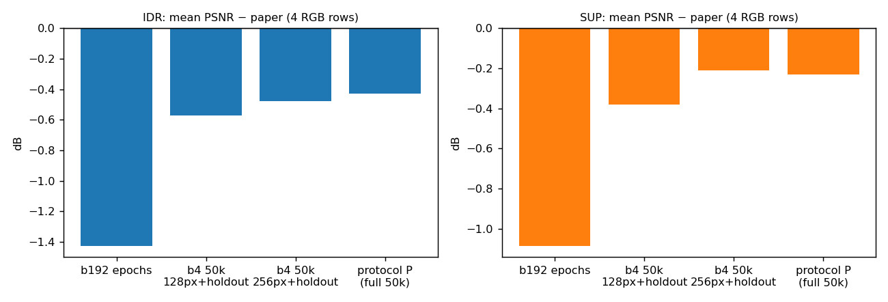

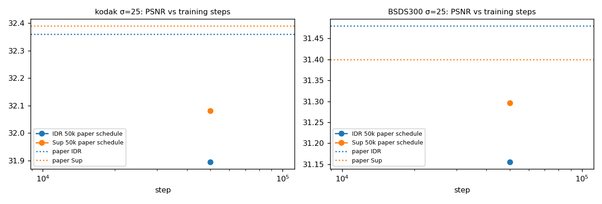

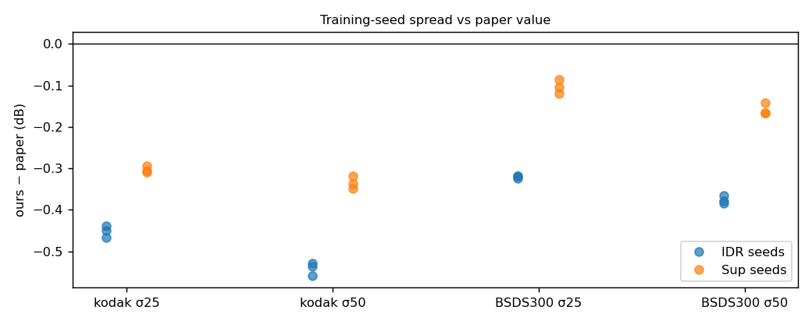

## 3. Image visualisations

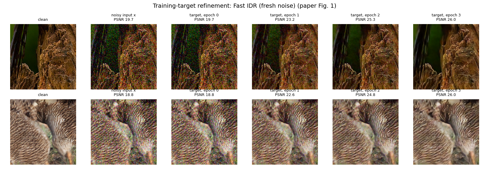

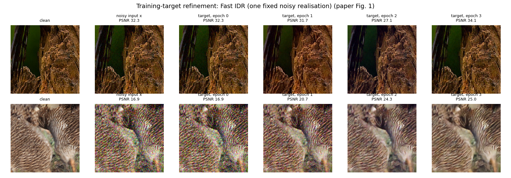

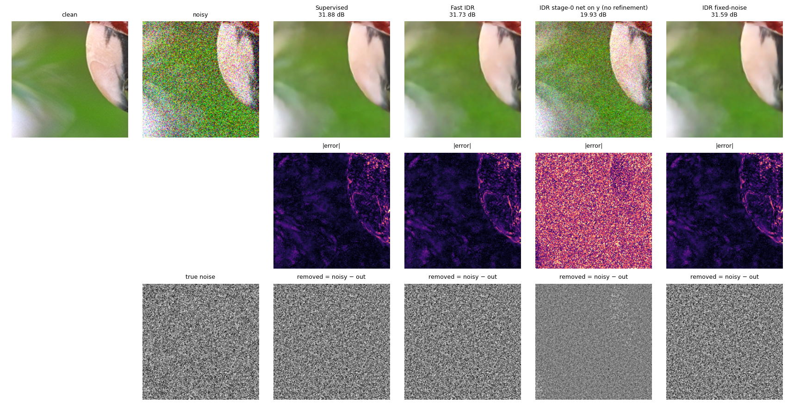

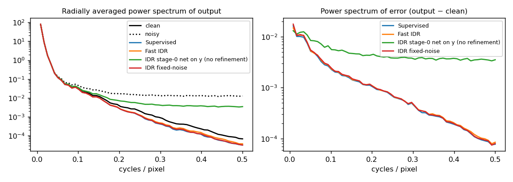

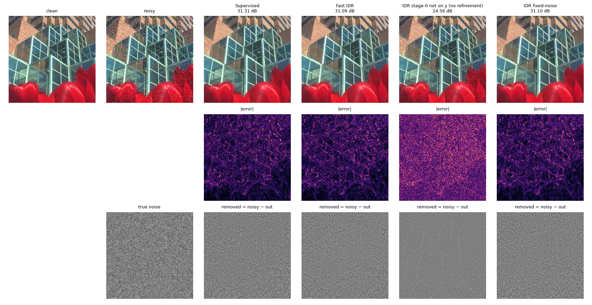

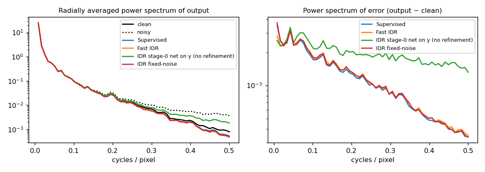

Per-image paired difference IDR − Sup (seed 0), with 95% bootstrap CI of the mean:

| σ | mean IDR−Sup | 95% CI | IDR wins |
|---|---|---|---|
| σ=25 | -0.145 | [-0.153, -0.137] | 0/324 |
| σ=50 | -0.135 | [-0.143, -0.127] | 1/324 |

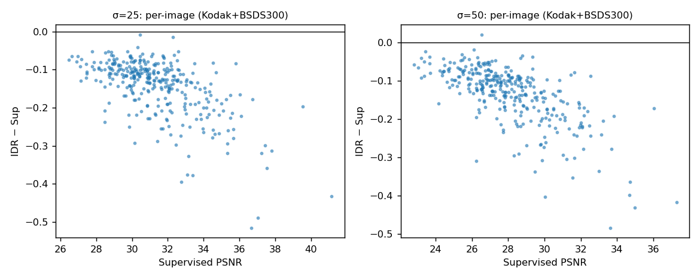

## 4. Seismic adaptation: synthetic surveys with clean reference

Output SNR (dB) over whole held-out sections, mean over 3 test-noise seeds (and training seeds 0–2 where shown ±sd). Input SNR shown for reference. Baselines on the identical noisy sections.

### sg: white Gaussian (paper: Gaussian)

| test | level | SNR in | IDR (n=3) | Sup (n=3) | Nr2N (2f(z)−z) | Nr2N K=8 | IDR stage-0 on y | N2N | IDR fixed | bandpass | fx | bm3d |
|---|---|---|---|---|---|---|---|---|---|---|---|---|
| m2 | 0.5 | 5.98 | 19.47±0.15 | 19.46±0.09 | 17.48 | 18.65 | 11.16 | 19.86 | 16.76 | 7.35 | 14.08 | 19.12 |
| m2 | 1.0 | -0.04 | 16.46±0.09 | 16.74±0.16 | 14.12 | 15.57 | 5.33 | 17.05 | 15.87 | 2.79 | 9.04 | 14.68 |
| m2_prestm | 0.5 | 4.80 | 17.37±0.04 | 15.67±0.17 | 15.47 | 16.40 | 9.91 | 16.40 | 15.15 | 7.44 | 13.94 | 16.38 |
| m2_prestm | 1.0 | -1.22 | 14.22±0.04 | 13.00±0.07 | 12.29 | 13.36 | 4.13 | 13.57 | 13.75 | 2.01 | 8.63 | 12.28 |
| m2_postm | 0.5 | 5.47 | 17.08±0.05 | 15.30±0.23 | 15.32 | 16.16 | 10.50 | 16.01 | 15.35 | 8.02 | 14.34 | 16.34 |
| m2_postm | 1.0 | -0.55 | 13.99±0.04 | 12.72±0.09 | 12.24 | 13.25 | 4.76 | 13.29 | 13.64 | 2.66 | 9.14 | 12.29 |
| m2_srme | 0.5 | 5.47 | 18.52±0.03 | 17.62±0.08 | 17.17 | 18.00 | 10.68 | 18.07 | 16.14 | 7.90 | 14.67 | 17.52 |
| m2_srme | 1.0 | -0.56 | 16.18±0.05 | 15.36±0.10 | 14.25 | 15.35 | 4.86 | 15.80 | 15.59 | 2.62 | 9.50 | 13.95 |
| ot | 0.5 | 5.99 | 19.07±0.06 | 19.96±0.01 | 16.65 | 18.44 | 10.94 | 19.88 | 19.25 | 9.31 | 11.20 | 16.47 |
| ot | 1.0 | -0.03 | 15.37±0.02 | 15.92±0.02 | 12.30 | 14.26 | 5.14 | 15.94 | 15.45 | 3.39 | 7.51 | 12.07 |
| sa | 0.5 | 6.01 | 23.24±0.02 | 24.42±0.20 | 20.42 | 21.98 | 11.36 | 24.00 | 22.99 | 9.36 | 9.23 | 20.89 |
| sa | 1.0 | -0.01 | 20.20±0.01 | 21.35±0.12 | 15.74 | 17.90 | 5.40 | 21.05 | 20.08 | 3.42 | 6.80 | 16.06 |
| f3 | 0.5 | 6.01 | 10.16±0.48 | 10.45±0.16 | 9.04 | 9.76 | 9.52 | 9.68 | 10.91 | 8.58 | 10.80 | 13.84 |
| f3 | 1.0 | -0.01 | 7.07±0.24 | 7.29±0.07 | 6.09 | 6.96 | 4.37 | 6.94 | 7.23 | 3.21 | 7.18 | 10.04 |
| st | 0.5 | 5.58 | 9.88±0.23 | 10.18±0.10 | 8.73 | 9.54 | 9.06 | 9.54 | 10.27 | 8.52 | 9.35 | 12.13 |
| st | 1.0 | -0.44 | 6.64±0.25 | 6.89±0.02 | 5.69 | 6.58 | 3.91 | 6.56 | 6.72 | 4.84 | 7.34 | 8.42 |

### sb: band-limited 5–60 Hz (paper: correlated)

| test | level | SNR in | IDR | Sup | IDR fixed | bandpass | fx | bm3d |
|---|---|---|---|---|---|---|---|---|
| m2 | 0.5 | 5.97 | 19.13 | 18.78 | 17.22 | 5.44 | 13.08 | 17.88 |
| m2 | 1.0 | -0.04 | 15.96 | 16.09 | 15.61 | 0.31 | 7.92 | 13.82 |
| m2_prestm | 0.5 | 4.79 | 16.13 | 14.43 | 14.70 | 5.03 | 12.78 | 15.21 |
| m2_prestm | 1.0 | -1.23 | 13.13 | 11.91 | 12.74 | -0.65 | 7.49 | 10.91 |
| m2_postm | 0.5 | 5.48 | 15.82 | 14.37 | 14.63 | 5.67 | 13.19 | 15.23 |
| m2_postm | 1.0 | -0.56 | 12.99 | 11.82 | 12.59 | -0.00 | 8.04 | 11.00 |
| m2_srme | 0.5 | 5.47 | 17.84 | 16.99 | 16.28 | 5.59 | 13.67 | 16.54 |
| m2_srme | 1.0 | -0.55 | 15.48 | 14.73 | 15.02 | -0.01 | 8.45 | 12.85 |
| ot | 0.5 | 5.99 | 17.26 | 18.06 | 17.51 | 6.60 | 10.08 | 14.69 |
| ot | 1.0 | -0.03 | 13.62 | 14.02 | 13.71 | 0.64 | 6.28 | 9.72 |
| sa | 0.5 | 6.01 | 22.30 | 23.51 | 22.33 | 6.65 | 8.65 | 19.52 |
| sa | 1.0 | -0.01 | 18.70 | 19.67 | 18.67 | 0.67 | 5.80 | 14.04 |
| f3 | 0.5 | 6.00 | 8.17 | 9.34 | 8.61 | 6.20 | 9.64 | 12.20 |
| f3 | 1.0 | -0.02 | 5.30 | 5.65 | 5.69 | 0.54 | 5.93 | 7.96 |
| st | 0.5 | 5.58 | 7.27 | 8.14 | 7.76 | 5.03 | 8.07 | 10.29 |
| st | 1.0 | -0.45 | 4.80 | 4.79 | 5.33 | -0.10 | 5.27 | 6.06 |

### ss: erratic spikes (paper: impulse)

| test | level | SNR in | IDR | Sup | fx | median |
|---|---|---|---|---|---|---|
| m2 | 0.05 | -1.51 | 18.24 | 21.70 | 7.75 | -0.26 |
| m2 | 0.1 | -4.51 | 15.39 | 18.61 | 5.00 | -0.26 |
| m2_prestm | 0.05 | -2.69 | 32.30 | 36.85 | 7.31 | -0.19 |
| m2_prestm | 0.1 | -5.69 | 28.25 | 32.55 | 4.52 | -0.22 |
| m2_postm | 0.05 | -2.00 | 32.26 | 36.84 | 7.86 | -0.16 |
| m2_postm | 0.1 | -5.03 | 28.67 | 32.67 | 5.09 | -0.21 |
| m2_srme | 0.05 | -2.01 | 29.77 | 34.88 | 8.20 | -0.53 |
| m2_srme | 0.1 | -5.04 | 26.19 | 31.16 | 5.36 | -0.54 |
| ot | 0.05 | -1.50 | 30.65 | 35.07 | 6.48 | 6.45 |
| ot | 0.1 | -4.50 | 26.85 | 31.13 | 4.22 | 6.05 |
| sa | 0.05 | -1.47 | 24.34 | 27.82 | 5.97 | 5.19 |
| sa | 0.1 | -4.48 | 21.51 | 25.87 | 3.97 | 4.94 |
| f3 | 0.05 | -1.47 | 21.16 | 20.36 | 6.17 | 9.36 |
| f3 | 0.1 | -4.50 | 17.74 | 17.69 | 3.94 | 8.74 |
| st | 0.05 | -1.90 | 23.08 | 23.13 | 6.69 | 8.53 |
| st | 0.1 | -4.91 | 19.20 | 19.81 | 5.14 | 8.07 |

### sd: dead traces (paper: binomial)

| test | level | SNR in | IDR | Sup | interp |
|---|---|---|---|---|---|
| m2 | 0.3 | 5.39 | 21.18 | 24.03 | 4.70 |
| m2 | 0.5 | 2.99 | 14.72 | 17.67 | 2.36 |
| m2_prestm | 0.3 | 5.14 | 28.13 | 28.52 | 23.27 |
| m2_prestm | 0.5 | 2.99 | 21.65 | 22.04 | 17.03 |
| m2_postm | 0.3 | 5.24 | 27.72 | 28.14 | 24.83 |
| m2_postm | 0.5 | 2.98 | 21.17 | 22.12 | 17.24 |
| m2_srme | 0.3 | 5.30 | 25.38 | 25.85 | 23.36 |
| m2_srme | 0.5 | 3.08 | 21.84 | 22.31 | 18.37 |
| ot | 0.3 | 5.17 | 19.51 | 19.69 | 16.60 |
| ot | 0.5 | 3.01 | 15.19 | 15.36 | 12.31 |
| sa | 0.3 | 5.26 | 14.38 | 15.58 | 13.00 |
| sa | 0.5 | 2.95 | 11.16 | 11.98 | 9.96 |
| f3 | 0.3 | 5.27 | 18.07 | 17.75 | 17.67 |
| f3 | 0.5 | 3.01 | 12.77 | 12.69 | 12.44 |
| st | 0.3 | 5.25 | 13.30 | 13.26 | 13.87 |
| st | 0.5 | 3.12 | 10.08 | 10.06 | 10.58 |

### Noise-model mismatch (mean over M2/OT/SA; σ=1.5 is outside the training range)

| model (trained on) | test noise | σ | SNR in | SNR out |
|---|---|---|---|---|
| C1_idr_sg_s0 | sg | 0.5 | 5.99 | 20.51 |
| C1_idr_sg_s0 | sg | 1.0 | -0.03 | 17.31 |
| C1_idr_sg_s0 | sg | 1.5 | -3.55 | 14.99 |
| C1_idr_sg_s0 | sb | 0.5 | 5.99 | 13.24 |
| C1_idr_sg_s0 | sb | 1.0 | -0.03 | 3.07 |
| C1_idr_sg_s0 | sb | 1.5 | -3.55 | -1.40 |
| C2_sup_sg_s0 | sg | 0.5 | 5.99 | 21.15 |
| C2_sup_sg_s0 | sg | 1.0 | -0.03 | 17.90 |
| C2_sup_sg_s0 | sg | 1.5 | -3.55 | 15.47 |
| C2_sup_sg_s0 | sb | 0.5 | 5.99 | 14.41 |
| C2_sup_sg_s0 | sb | 1.0 | -0.03 | 2.76 |
| C2_sup_sg_s0 | sb | 1.5 | -3.55 | -1.86 |
| C7_idr_sb_s0 | sg | 0.5 | 5.99 | 19.87 |
| C7_idr_sb_s0 | sg | 1.0 | -0.03 | 16.50 |
| C7_idr_sb_s0 | sg | 1.5 | -3.55 | 13.88 |
| C7_idr_sb_s0 | sb | 0.5 | 5.99 | 19.56 |
| C7_idr_sb_s0 | sb | 1.0 | -0.03 | 16.09 |
| C7_idr_sb_s0 | sb | 1.5 | -3.55 | 13.51 |
| C7_sup_sb_s0 | sg | 0.5 | 5.99 | 19.84 |
| C7_sup_sb_s0 | sg | 1.0 | -0.03 | 16.44 |
| C7_sup_sb_s0 | sg | 1.5 | -3.55 | 12.55 |
| C7_sup_sb_s0 | sb | 0.5 | 5.99 | 20.12 |
| C7_sup_sb_s0 | sb | 1.0 | -0.03 | 16.59 |
| C7_sup_sb_s0 | sb | 1.5 | -3.55 | 13.69 |

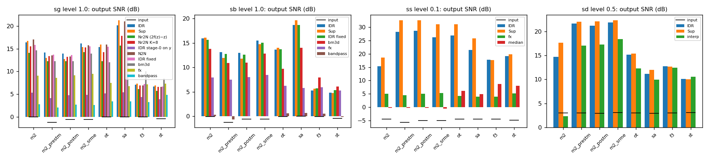

## 5. Seismic visualisations

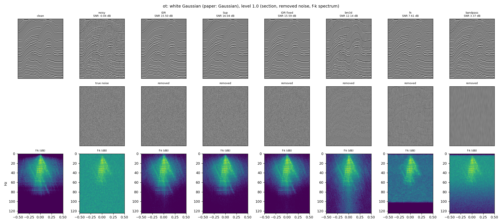

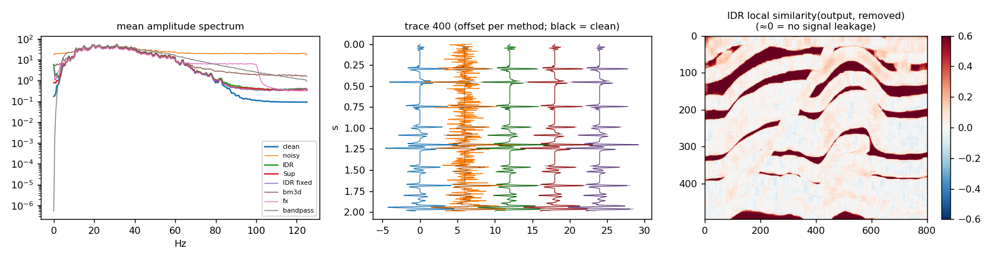

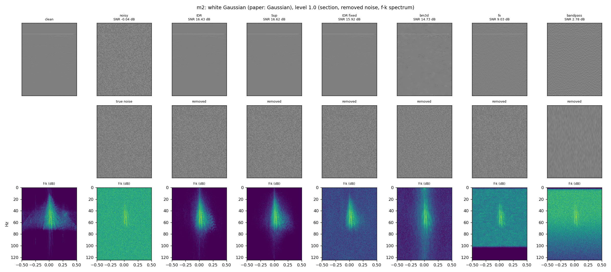

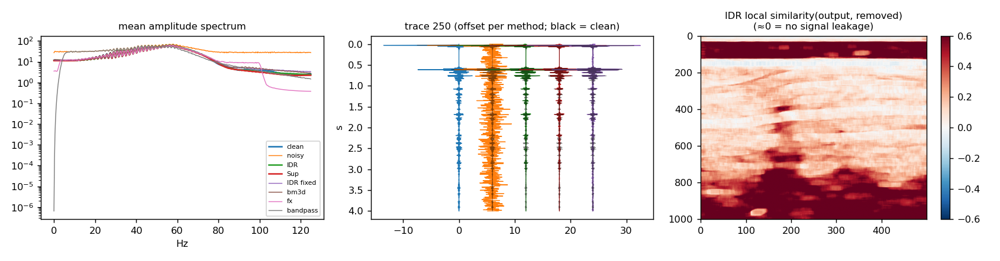

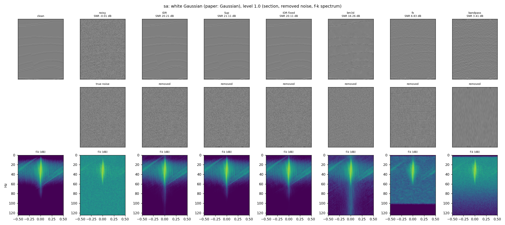

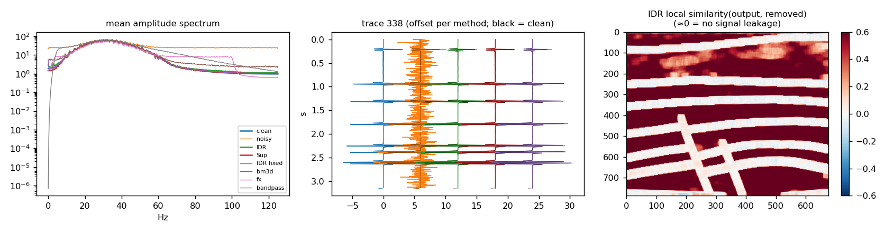

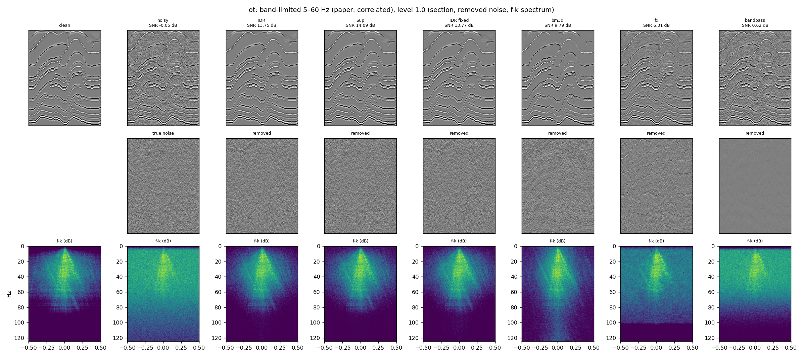

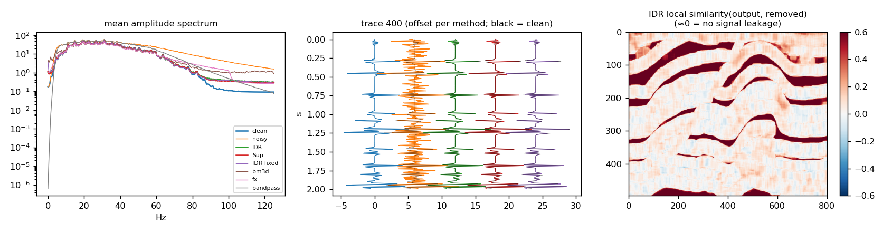

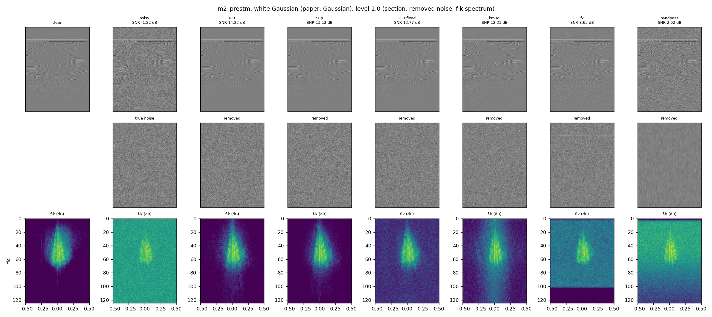

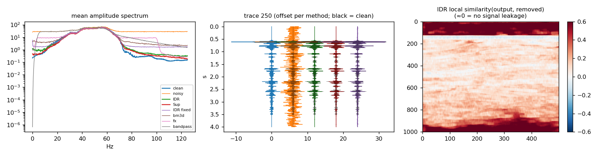

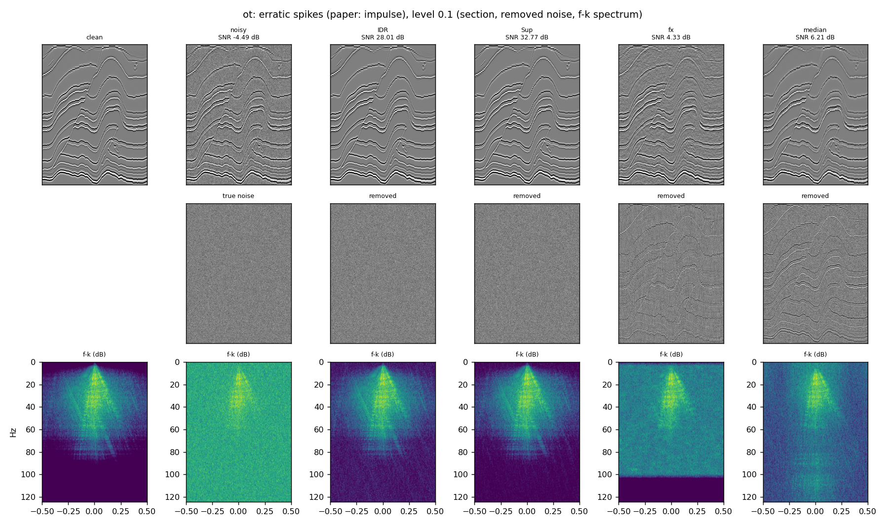

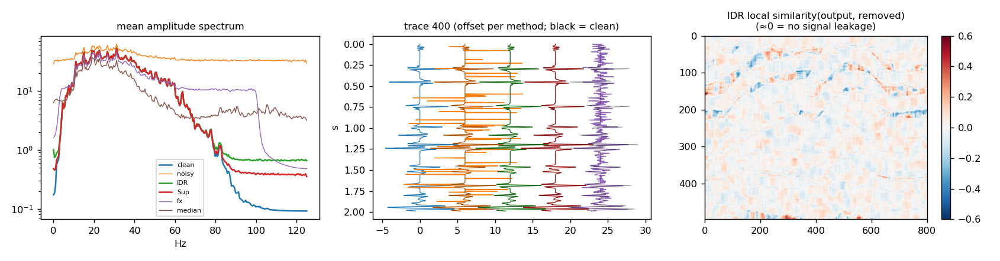

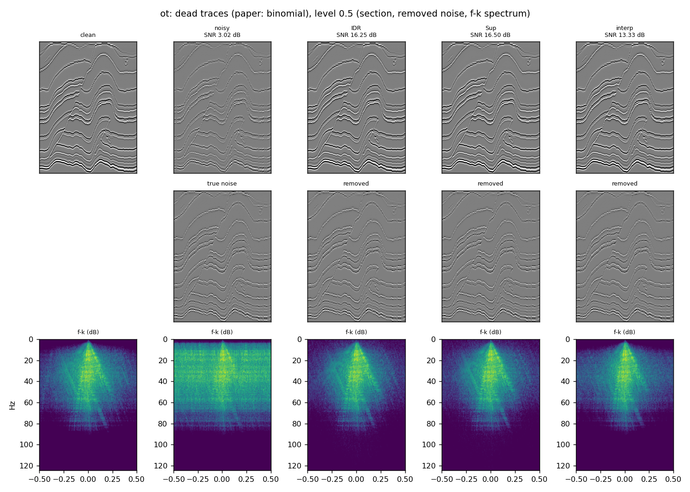

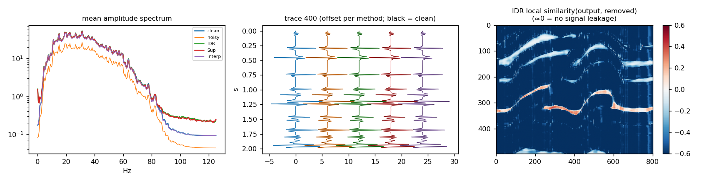

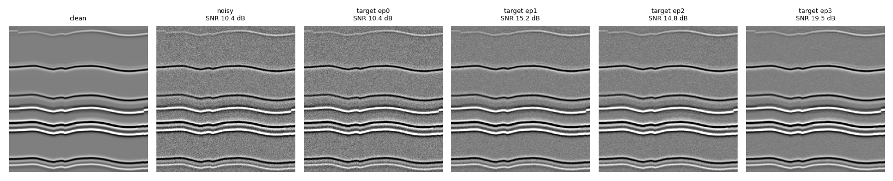

## 6. Field data (no clean reference)

**F3 Netherlands (marine 3-D field), semi-synthetic** (white noise added to field sections; reference = original field section):

| model | SNR out σ=0.5 | SNR out σ=1.0 |
|---|---|---|
| IDR trained on noisy field data (fixed realisation) | 14.97 | 11.41 |
| Supervised on field-as-clean (oracle, domain-matched) | 14.69 | 11.04 |
| IDR on synthetic corpus | 10.82 | 7.35 |
| Supervised on synthetic corpus | 10.48 | 7.28 |

**F3 Netherlands (marine 3-D field), real noise** (models applied to raw field sections):

| model | removed energy % | removed % in 5–60 Hz | removed % outside band | mean |local sim| (leakage) |
|---|---|---|---|---|
| idr_real | 0.02 | 0.01 | 0.18 | 0.124 |
| idr_synth | 1.09 | 0.75 | 4.64 | 0.311 |
| sup_synth | 1.52 | 0.80 | 8.80 | 0.263 |
| idr_fixed_f3 | 0.01 | 0.01 | 0.05 | 0.168 |

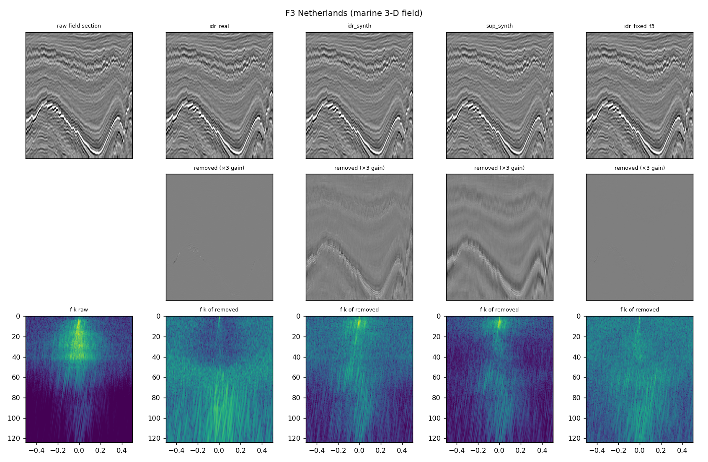

**Stratton 3-D (land field), semi-synthetic** (white noise added to field sections; reference = original field section):

| model | SNR out σ=0.5 | SNR out σ=1.0 |
|---|---|---|
| IDR trained on noisy field data (fixed realisation) | 13.30 | 9.62 |
| Supervised on field-as-clean (oracle, domain-matched) | 13.43 | 9.66 |
| IDR on synthetic corpus | 10.20 | 6.94 |
| Supervised on synthetic corpus | 10.25 | 6.87 |

**Stratton 3-D (land field), real noise** (models applied to raw field sections):

| model | removed energy % | removed % in 5–60 Hz | removed % outside band | mean |local sim| (leakage) |
|---|---|---|---|---|
| idr_real | 0.04 | 0.01 | 0.18 | 0.054 |
| idr_synth | 0.90 | 0.75 | 1.64 | 0.361 |
| sup_synth | 0.73 | 0.79 | 0.57 | 0.338 |
| idr_fixed_st | 0.03 | 0.01 | 0.09 | 0.511 |

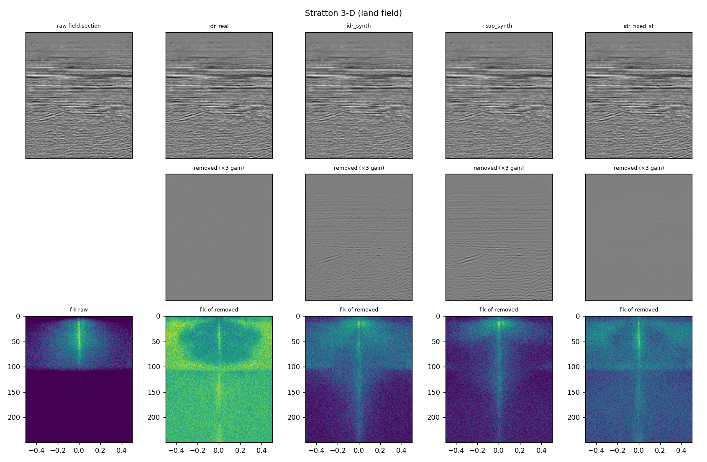

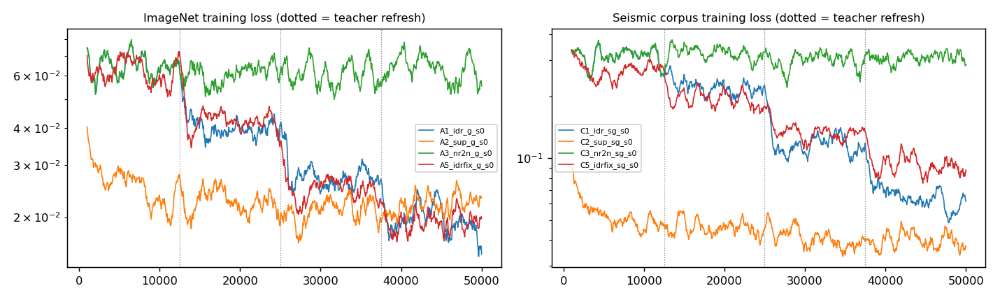

