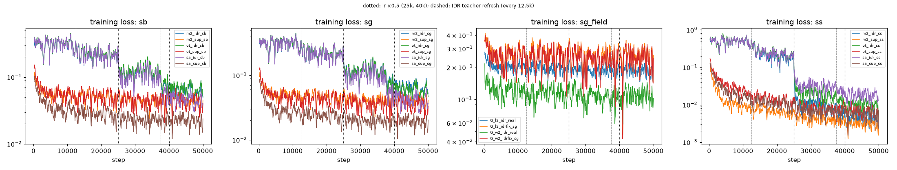
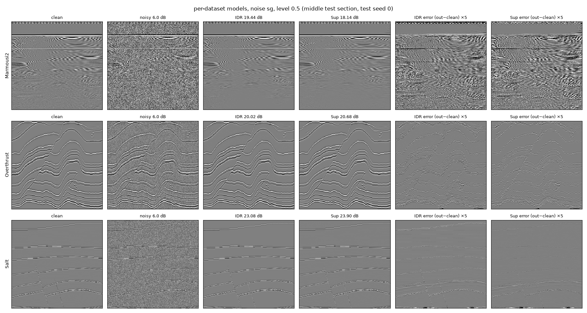
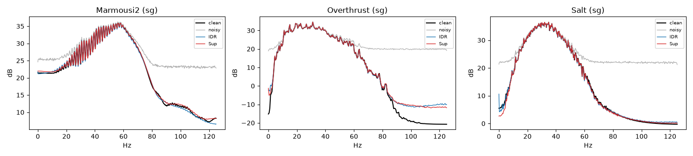
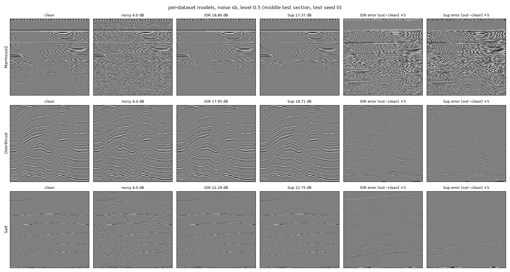
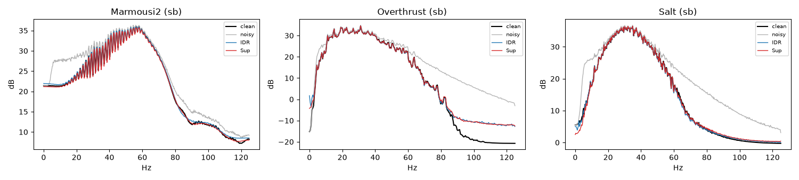
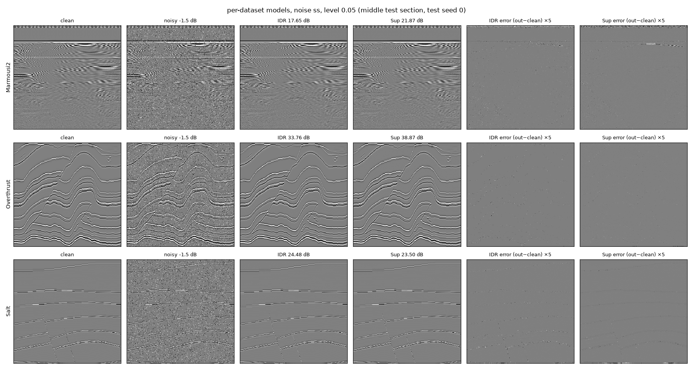
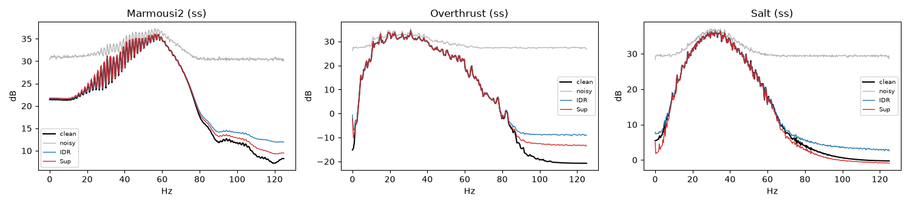

# Sanity checks: Kaggle runs (27 Nov 2026)

Generated by `kgl/sanity.py` from the downloaded run folders. Local inference is on CPU (PyTorch), using the downloaded `weights.pth` and the noisy section stored by the Kaggle evaluation.

Own-test SNR is the mean over test sections × 3 noise seeds; the local check uses one stored section (middle, seed 0).

| run | steps | it/s | final loss (mean last 1k) | own-test SNR in → out (dB) | gain | local−Kaggle max|Δ| | 1-section SNR local / Kaggle |
|---|---|---|---|---|---|---|---|
| G_l2_idr_real | 50000 | 4.55 | 0.1757 | — | — | — | — |
| G_l2_idrfix_sg | 50000 | 4.53 | 0.2298 | 6.01 → 11.51 | +5.50 | 3.8e-06 | 11.49 / 11.49 |
| G_w2_idr_real | 50000 | 4.24 | 0.1032 | — | — | — | — |
| G_w2_idrfix_sg | 50000 | 4.52 | 0.2226 | 4.93 → 8.53 | +3.60 | 4.8e-06 | 8.59 / 8.59 |
| S_m2_idr_sb_s0 | 50000 | 3.25 | 0.0629 | 5.97 → 18.82 | +12.85 | 1.5e-05 | 18.80 / 18.80 |
| S_m2_idr_sg_s0 | 50000 | 4.42 | 0.0648 | 5.98 → 19.47 | +13.49 | 1.5e-05 | 19.44 / 19.44 |
| S_m2_idr_ss_s0 | 50000 | 4.42 | 0.0036 | -1.51 → 17.87 | +19.39 | 1.7e-05 | 17.65 / 17.65 |
| S_m2_sup_sb_s0 | 50000 | 4.30 | 0.0422 | 5.97 → 17.40 | +11.43 | 1.7e-05 | 17.37 / 17.37 |
| S_m2_sup_sg_s0 | 50000 | 5.82 | 0.0389 | 5.98 → 18.17 | +12.19 | 1.9e-05 | 18.14 / 18.14 |
| S_m2_sup_ss_s0 | 50000 | 5.47 | 0.0026 | -1.51 → 22.49 | +24.01 | 1.7e-05 | 21.87 / 21.87 |
| S_ot_idr_sb_s0 | 50000 | 3.20 | 0.0673 | 5.99 → 17.56 | +11.57 | 5.2e-06 | 17.95 / 17.95 |
| S_ot_idr_sg_s0 | 50000 | 4.74 | 0.0618 | 5.99 → 19.57 | +13.58 | 4.3e-06 | 20.02 / 20.02 |
| S_ot_idr_ss_s0 | 50000 | 4.52 | 0.0089 | -1.50 → 31.57 | +33.07 | 6.2e-06 | 33.76 / 33.76 |
| S_ot_sup_sb_s0 | 50000 | 4.36 | 0.0400 | 5.99 → 18.16 | +12.17 | 5.2e-06 | 18.71 / 18.71 |
| S_ot_sup_sg_s0 | 50000 | 5.72 | 0.0332 | 5.99 → 20.23 | +14.25 | 4.8e-06 | 20.68 / 20.68 |
| S_ot_sup_ss_s0 | 50000 | 5.63 | 0.0054 | -1.50 → 34.83 | +36.33 | 7.6e-06 | 38.87 / 38.87 |
| S_sa_idr_sb_s0 | 50000 | 3.39 | 0.0473 | 6.01 → 22.38 | +16.36 | 5.7e-06 | 22.29 / 22.29 |
| S_sa_idr_sg_s0 | 50000 | 4.76 | 0.0444 | 6.01 → 23.39 | +17.37 | 7.6e-06 | 23.08 / 23.08 |
| S_sa_idr_ss_s0 | 50000 | 4.62 | 0.0168 | -1.47 → 24.53 | +26.00 | 8.6e-06 | 24.48 / 24.48 |
| S_sa_sup_sb_s0 | 50000 | 4.36 | 0.0215 | 6.01 → 22.87 | +16.85 | 5.7e-06 | 22.75 / 22.75 |
| S_sa_sup_sg_s0 | 50000 | 5.84 | 0.0183 | 6.01 → 24.19 | +18.17 | 5.2e-06 | 23.90 / 23.90 |
| S_sa_sup_ss_s0 | 50000 | 5.78 | 0.0054 | -1.47 → 26.12 | +27.59 | 8.1e-06 | 23.50 / 23.50 |

## Red flags

- S_m2_*_sg: IDR beats supervised by +1.30 dB on its own training survey (check)
- S_m2_*_sb: IDR beats supervised by +1.42 dB on its own training survey (check)

## Follow-up on red flags

**S_m2_*_sg (IDR +1.30 dB above supervised on Marmousi2).** Checked by scoring the 10k–50k checkpoints on the m2 test set
(σ 0.5, 3 seeds, local CPU inference):

| step | IDR | Sup |
|---|---|---|
| 10k | 8.20 | **19.14** |
| 20k | 10.51 | 16.04 |
| 30k | 19.20 | 18.35 |
| 40k | 19.06 | 18.35 |
| 50k | **19.47** | 18.17 |

Supervised peaks at 10k and then over-fits its single 1001×1400 training section. IDR is low before the first teacher
refresh (stage-0 network under-denoises, as expected) and keeps improving. **Not a bug: a small-data over-fitting
effect.** Fair statement: IDR at 50k ≈ supervised with early stopping (19.47 vs 19.14); the joint-corpus supervised model
(more data) reaches 19.34.

## Figures

