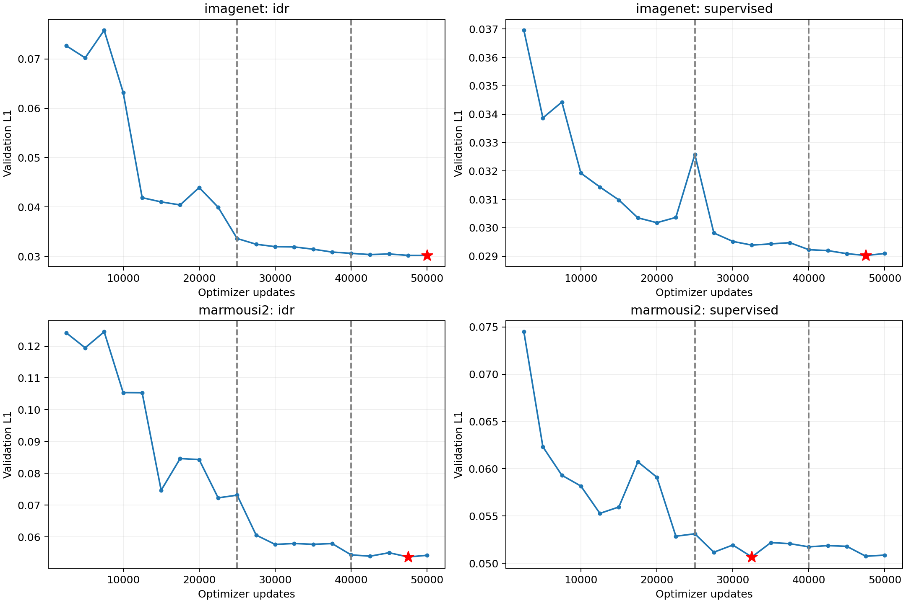

# Audit of the four completed batch-4 / 50,000-update runs

## Scope and verdict

These are modified Fast-IDR and supervised U-Net experiments, not an exact reproduction of the paper. All four final checkpoints have exactly 50,000 Adam updates, batch size 4, and the paper's stated learning-rate schedule. The U-Net implementation and core target-generation algorithm match the released source. The principal scientific differences are 256→128 downsampling and a 49,000/1,000 ImageNet split. Marmousi2 is a separate synthetic-noise extension, absent from the IDR paper.

Only `runs/steps50k_b4_128/{imagenet,marmousi2}/{idr,supervised}` is included. Earlier large-batch epoch-based runs and continuation experiments are excluded. This audit evaluated the previously missing final/best supervised ImageNet and both seismic checkpoints. Existing ImageNet Fast-IDR evaluations were retained; its best and final checkpoint are at the same step.

## Sources and provenance

- Paper: [IDR, arXiv:2111.14358v2, 22 March 2022](https://arxiv.org/abs/2111.14358v2), locally `IDR/paper.pdf`. Section 5.1 gives settings; Table 2 gives Gaussian benchmark results; Algorithm 1 and Section 3.3 define Fast-IDR. Table 2 labels the grayscale dataset BSD64 although the prose says BSD68; no grayscale paper comparison is attempted here.
- Official [repository](https://github.com/zhangyi-3/IDR/tree/7061caa7360008135e7f732f82b94f7b230e59b1), commit `7061caa7360008135e7f732f82b94f7b230e59b1`. Tracked upstream files are unmodified.
- Local entry point: `repro/train_steps50k.py` → `gaussian.make_model` → `DenoiseBase_fastIDR` or `DenoiseBase_n2c` → `UNet_n2n_un`. These are actual saved-run configuration paths, not the earlier epoch driver.
- Published reproduction commit: `9bcf2e67ac17e9c648335b7fc5998317cfda4dd8`. The current training entry point matches that commit's checkout byte for byte. Core training files predate these runs. Current code hashes and modification times are in [source_manifest.json](source_manifest.json); upstream edits are in [upstream_changes.diff](upstream_changes.diff); key current files are preserved in `source_snapshot/`.
- Historical limitation: checkpoints did not embed a source-tree hash or code snapshot. Saved configuration, console invocations, unchanged committed code, modification times, and optimizer state provide strong consistency evidence, but cannot prove the exact historical source bytes. The audit snapshots are taken now, not at run start.
- [artifact_checks.json](artifact_checks.json) records checkpoint hashes and independently checked optimizer/update counts, batch sizes, LR transitions, finite losses, and final-weight equality. No training weights were changed during the audit.

## Completion and actual runtime

| Dataset | Method | Final updates | Samples per epoch | Epoch equivalents | First–last update span (min) | Replayed log rows |
|---|---|---|---|---|---|---|
| imagenet | idr | 50,000 | 49000 | 4.0816 | 23.60 | 0 |
| imagenet | supervised | 50,000 | 49000 | 4.0816 | 35.37 | 947 |
| marmousi2 | idr | 50,000 | 50000 | 4.0000 | 25.64 | 0 |
| marmousi2 | supervised | 50,000 | 50000 | 4.0000 | 23.14 | 0 |

Every retained step from 1 through 50,000 is present and every batch has four samples. Each final trajectory used 200,000 sample presentations. The ImageNet supervised process stopped after logging through step 6,947 and resumed from the saved step-6,000 checkpoint, replaying 947 updates. Its log therefore has 50,947 rows, but the final optimizer state is 50,000, not 50,947. Analyses deduplicate by step, retaining the last occurrence. Two failed starts without `--resume` did not overwrite the checkpoint.

Runtime is the timestamp span from first to last update, including in-loop validation, checkpoint saves, interruptions and GPU sharing; it excludes initial setup and the final validation/evaluation. ImageNet supervised overlaps both seismic jobs. These are not isolated throughput measurements and should not be used to claim a hardware speedup over the paper.

## Protocol comparison

| Item | Paper / original repository | These completed runs | Consequence |
|---|---|---|---|
| Method | Fast-IDR for main comparisons (Section 5.1) | `idr` selects Fast-IDR, not full multi-round IDR | Matches method family |
| Network | Shallow U-Net without batch normalization | Unchanged `models/unet.py`; 991,203 parameters RGB, 988,609 seismic | Same backbone; seismic changes channel counts |
| Optimizer / objective | Adam, L1, initial LR 0.0003 | Same; beta=(0.9,0.999), eps=1e-8, weight decay=0; no gradient clipping, EMA, accumulation or mixed precision | Core optimization matches |
| Batch / update budget | Paper: 4 / 50,000 | 4 / 50,000 | Matches stated paper budget |
| LR schedule | Paper halves at 25k and 40k; released YAML instead uses cosine over 500k | 0.0003 for updates 1–25,000; 0.00015 for 25,001–40,000; 0.000075 for 40,001–50,000 | Deliberately follows paper, not released defaults |
| ImageNet training source | ImageNet validation split, 256×256 random patches | HF validation-only 50k source; 49k training, 1k held out | 2% fewer training images; changed epoch boundaries |
| Image preparation | 256×256 crop; small images resized to 256 square | Same crop rule, then area-downsample clean crop to 128×128 before adding noise | Different texture statistics and context; quarter the output pixel count |
| Image augmentation | Released config: off, repeat=1 | Off, repeat=1 | Matches |
| Synthetic noise | Gaussian training sigma in [0,50] on 0–255 scale | Same for RGB; one sigma per batch per noise call | Matches Gaussian law, not necessarily the random realization |
| Seismic | Not studied in paper | Native 128×128 patches; sigma in [0,0.5] in train-RMS units | New task; no published IDR seismic baseline |
| Validation / selection | No matching holdout/selection procedure specified in cited paper settings | Every 2,500 updates; clean-reference L1; save final and best | Best selection uses clean information; final step is primary comparison |
| Stopping | Fixed iteration budget | No early stopping | All four completed fixed budget |
| Loader / runtime | Cluster SLURM/DDP, memcached; worker_num=1 in YAML | Single GPU, local files, four workers, sorted recursive file list, seed 2026 | Portability and sampling order differences |
| Numerics | Original software/hardware environment | PyTorch 2.7.1+cu128, RTX 5070 Ti; FP32, TF32 off, deterministic cuDNN | Exact cross-environment numerical identity not established |

The paper and released defaults disagree: `IDR/configs/IDR.yaml` specifies `total_iter: 500000` and `schedule: cosine`, while Section 5.1 explicitly states 50k and two halvings. It is incorrect to describe this run as an unchanged invocation of the upstream repository.

The ImageNet crop contains 16,384 output pixels instead of 65,536. With 200k presentations, that is 3.2768 billion versus 13.1072 billion spatial pixel positions (before RGB channels), although each downsampled crop still covers the original 256×256 region. Same updates and batch size do not make the information content identical.

## Exact Fast-IDR training behavior

Let y be the clean/reference patch, x=y+n1 a newly synthesized noisy observation, T the frozen previous-epoch network, and S the student. Gaussian noise is generated afresh on every sample visit. RGB tensors are shifted by −0.5; seismic tensors are not shifted.

1. During the first loader epoch, target=x and student input=x+n2. Minimize mean absolute error |S(x+n2)−x|.
2. At the beginning of each later loader epoch, copy the current student into T. For each batch set target=T(x), computed in evaluation mode without gradients, and input=T(x)+n2. Minimize |S(T(x)+n2)−T(x)|.
3. Continue optimizing the same student and Adam state. The teacher is frozen within the epoch; it is not an exponential moving average. Only the student is used at inference.

n1 and n2 use independent sigma draws and independent Gaussian samples. The upstream helper draws a sigma vector but, with `mixed_batch_nl=False`, applies only its first value across the batch. Fast-IDR uses the reference to synthesize observations, but the reference is not its optimization target. Supervised U-Net instead minimizes |S(y+n1)−y|. Supervised training also takes 50,000 optimizer steps.

ImageNet has 12,250 steps per loader epoch. Teacher refreshes occur immediately before updates 12,251, 24,501, 36,751 and 49,001. Seismic has 12,500 steps per epoch, with refreshes before 12,501, 25,001 and 37,501. Using the full 50k ImageNet set at batch 4 would ordinarily produce four complete epochs and three post-initial refreshes; the holdout therefore changes more than data count.

The paper describes noisy images and constructing refined datasets between epochs. The released synthetic trainer generates fresh noisy observations and computes teacher targets online instead. These runs preserve that released-code behavior; they do not cache a single fixed noisy dataset or precompute all pseudo-targets in a separate inference sweep. No extra alpha interpolation/blending curriculum exists in this driver.

## Data and evaluation details

ImageNet was exported without re-encoding from `ILSVRC/imagenet-1k`, revision `49e2ee26f3810fb5a7536bbf732a7b07389a47b5`, validation only (14 parquet shards). Split seed is 2026. A deterministic filename-level 49k/1k split prevents image overlap. The original downloaded split is a training source for denoising, not ImageNet classification training. The paper does not supply an identical filename/seed manifest.

ImageNet validation uses fixed centered 256 crops reduced to 128, seeded noise at sigma 25 and 50, and equally weighted unclipped float L1 means. Kodak and BSDS300 are not used for validation or checkpoint selection. Benchmark evaluation uses all 24 Kodak and all 300 BSDS300 images at full native resolution, sigma 25 and 50, padding by reflection to multiples of 32 and removing padding afterward. Outputs are rounded/clipped to uint8; PSNR and RGB-channel SSIM use data_range=255, then image-wise arithmetic means. No test-time augmentation is used.

The RGB evaluator converts OpenCV BGR to RGB, consistent with the training loader. The released `test.py` feeds BGR directly. Also, our evaluator sorts files and resets a local RandomState(2026) per dataset/noise level; upstream uses unseeded global NumPy draws and filesystem order. The current scikit-image `channel_axis=-1` replaces the old `multichannel=True` API. Consequently, paper gaps are benchmark-score comparisons, not identical-noise, identical-test-code replication errors. The BGR/RGB choice can affect a trained network and is not merely a display change.

Marmousi2 uses the processed synthetic `NMOstack_time` section, shape 1001 time samples × 2721 traces, sample interval 4 ms. It is not raw field acquisition and not the velocity model. Training traces [0,1632), validation [1760,2176), test [2304,2721) have 128-trace guard bands. Signed amplitudes are divided by training-region RMS 9.185504913068213e-05, with no clipping, centering, image conversion or downsampling. Each epoch draws 50k random 128×128 crops, not 50k distinct seismic images.

Seismic validation and test each use 21 fixed nonoverlapping tiles and sigma 0.1, 0.2, 0.4. SNR means exclude zero-signal tiles (only 7 test tiles contain signal); RMSE includes all 21. The metrics are means of tile-wise scores, not global whole-section SNR. Bottom/right remainder pixels are not evaluated. This small test region from one synthetic section cannot establish generalization to other surveys, coherent noise or real-world raw noise. Seismic models were trained separately from scratch; no ImageNet weights were transferred.

## Validation behavior

| Dataset | Method | L1 at 2.5k | L1 at 40k | Final L1 | Best L1 | Best step |
|---|---|---|---|---|---|---|
| imagenet | idr | 0.072673 | 0.030604 | 0.030166 | 0.030166 | 50000 |
| imagenet | supervised | 0.036955 | 0.029226 | 0.029092 | 0.029022 | 47500 |
| marmousi2 | idr | 0.124192 | 0.054370 | 0.054242 | 0.053708 | 47500 |
| marmousi2 | supervised | 0.074481 | 0.051736 | 0.050864 | 0.050665 | 32500 |

Fast-IDR's large early reductions align with teacher refinement, so raw training loss across epochs is not a fixed-target convergence metric. Clean-reference validation is the more useful trajectory. ImageNet Fast-IDR achieves its best at 50k but improves only slightly in the final interval; ImageNet supervised's best is at 47.5k. Both seismic models reach their best before 50k. These curves do not show that all runs simply needed more epochs. Additional training might help some cases, but cannot be promised to close the paper gap. It would also exceed the fixed 50k comparison budget. No repeated seeds or confidence intervals were run.

## Paper result gaps: primary final checkpoints

Paper numbers are Table 2's `Ours` (Fast-IDR) and `Supervised`, not MPRNet or full-IDR ablations. Delta means our score minus the corresponding paper score; negative is worse. SSIM differences are absolute units. Rows are equally weighted only when explicitly averaging across the four benchmark/noise combinations.

| Method | Dataset | σ | Paper PSNR | Our PSNR | Δ dB | Paper SSIM | Our SSIM | Δ SSIM |
|---|---|---|---|---|---|---|---|---|
| idr | kodak | 25 | 32.36 | 31.7529 | -0.6071 | 0.884 | 0.871071 | -0.012929 |
| idr | kodak | 50 | 29.27 | 28.5786 | -0.6914 | 0.803 | 0.778138 | -0.024862 |
| idr | BSDS300 | 25 | 31.48 | 31.0108 | -0.4692 | 0.890 | 0.879684 | -0.010316 |
| idr | BSDS300 | 50 | 28.25 | 27.7287 | -0.5213 | 0.802 | 0.780820 | -0.021180 |
| supervised | kodak | 25 | 32.39 | 31.9051 | -0.4849 | 0.885 | 0.874145 | -0.010855 |
| supervised | kodak | 50 | 29.24 | 28.7693 | -0.4707 | 0.803 | 0.783235 | -0.019765 |
| supervised | BSDS300 | 25 | 31.40 | 31.1229 | -0.2771 | 0.889 | 0.881790 | -0.007210 |
| supervised | BSDS300 | 50 | 28.17 | 27.8776 | -0.2924 | 0.799 | 0.785254 | -0.013746 |

idr: mean PSNR gap over these four rows = -0.5722 dB. This is not the paper's six-row color-plus-gray average.

supervised: mean PSNR gap over these four rows = -0.3813 dB. This is not the paper's six-row color-plus-gray average.

## Secondary best-validation checkpoints

These checkpoints use clean-reference validation selection and are not necessarily step 50k. Do not substitute them silently into the fixed-budget final result.

| Method | Dataset | σ | Paper PSNR | Our PSNR | Δ dB | Paper SSIM | Our SSIM | Δ SSIM |
|---|---|---|---|---|---|---|---|---|
| idr | kodak | 25 | 32.36 | 31.7529 | -0.6071 | 0.884 | 0.871071 | -0.012929 |
| idr | kodak | 50 | 29.27 | 28.5786 | -0.6914 | 0.803 | 0.778138 | -0.024862 |
| idr | BSDS300 | 25 | 31.48 | 31.0108 | -0.4692 | 0.890 | 0.879684 | -0.010316 |
| idr | BSDS300 | 50 | 28.25 | 27.7287 | -0.5213 | 0.802 | 0.780820 | -0.021180 |
| supervised | kodak | 25 | 32.39 | 31.9071 | -0.4829 | 0.885 | 0.875023 | -0.009977 |
| supervised | kodak | 50 | 29.24 | 28.7696 | -0.4704 | 0.803 | 0.782917 | -0.020083 |
| supervised | BSDS300 | 25 | 31.40 | 31.1385 | -0.2615 | 0.889 | 0.882532 | -0.006468 |
| supervised | BSDS300 | 50 | 28.17 | 27.8799 | -0.2901 | 0.799 | 0.784145 | -0.014855 |

## Marmousi2 held-out test results

No seismic result exists in this paper; the meaningful comparison is between our two methods under the same held-out corruption.

| Checkpoint | Method | σ | Input SNR dB | Output SNR dB | Gain dB | Normalized RMSE | Signal correlation |
|---|---|---|---|---|---|---|---|
| final | idr | 0.1 | 11.754 | 19.050 | 7.296 | 0.019369 | 0.983373 |
| final | idr | 0.2 | 5.733 | 16.332 | 10.599 | 0.024382 | 0.966748 |
| final | idr | 0.4 | -0.287 | 13.201 | 13.488 | 0.032973 | 0.921606 |
| final | supervised | 0.1 | 11.754 | 19.375 | 7.621 | 0.014137 | 0.983149 |
| final | supervised | 0.2 | 5.733 | 16.339 | 10.606 | 0.019888 | 0.964151 |
| final | supervised | 0.4 | -0.287 | 13.292 | 13.580 | 0.028333 | 0.925191 |
| best | idr | 0.1 | 11.754 | 19.154 | 7.400 | 0.018966 | 0.983835 |
| best | idr | 0.2 | 5.733 | 16.412 | 10.679 | 0.023957 | 0.967591 |
| best | idr | 0.4 | -0.287 | 13.290 | 13.577 | 0.032722 | 0.926344 |
| best | supervised | 0.1 | 11.754 | 19.486 | 7.733 | 0.014004 | 0.983760 |
| best | supervised | 0.2 | 5.733 | 16.491 | 10.757 | 0.019559 | 0.965471 |
| best | supervised | 0.4 | -0.287 | 13.257 | 13.545 | 0.028423 | 0.924532 |

## Interpretation and what would make the comparison closer

The runs recover strong denoising, but do not match the published RGB scores. Both supervised and Fast-IDR are below their corresponding paper baselines, so the discrepancy is not isolated to the refinement algorithm. The shared resolution/preprocessing change is a plausible contributor, as are the changed data split, color-order test path, random realization, software environment and sampling. This audit does not isolate their causal effects; assigning a percentage of the gap to any one change would require controlled reruns.

A closer paper-protocol rerun would use 256×256 outputs without area downsampling, all 50k ImageNet validation images as the training source, batch 4, 50k updates, the same Adam/L1 and 25k/40k schedule, and final-checkpoint reporting. Keep a clearly documented RGB/BGR evaluation choice and, ideally, evaluate both color-order paths and several noise seeds rather than claiming either reproduces unspecified paper details. Do not change to the released 500k/cosine default while labeling it the paper's stated training protocol. No such rerun was started during this audit.

Engineering edits relative to original files are limited to non-DDP device handling, device-aware Gaussian tensor allocation (also enabling CPU tests), Python-file-only module discovery, recursive/sorted image discovery, area downsampling, suppression of optional memcached warnings, and efficient NumPy→tensor conversion for inference. The new driver adds explicit splits, seeding, schedule, structured logs, checkpoint/resume state and validation. The architecture file is identical to upstream. Gaussian allocation changes preserve the distribution, not a guarantee of identical RNG outputs across PyTorch versions.

Validation monitoring uses clean references even for Fast-IDR. The fixed final checkpoint is not selected by clean validation, but secondary best-checkpoint selection is. Therefore the complete best-selection workflow should not be described as needing no clean data whatsoever.

## Reusable audit artifacts

- [All evaluation results](evaluation_results.csv), including final and best; [paper gaps](paper_gaps.csv).
- [Validation values](validation_values.csv), [PNG curves](validation_curves.png), [PDF curves](validation_curves.pdf).
- [Checkpoint verification and hashes](artifact_checks.json), [source hashes](source_manifest.json), [upstream code differences](upstream_changes.diff).
- Full per-image/per-tile metrics remain in each run's `evaluation_final/` and `evaluation_best/` directory. Original checkpoints, configs, manifests, console logs and per-update logs remain in their run directories.

