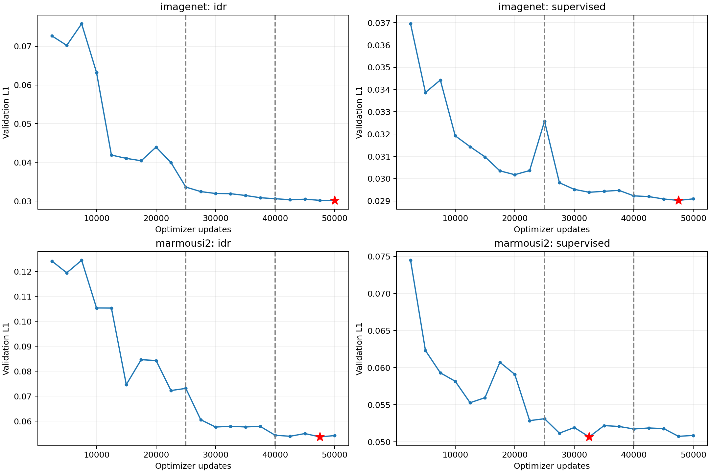

# Batch 4 / 50,000-step experiment results

All models trained for exactly 50,000 optimizer updates at 128x128. No early stopping.
Final-step scores are the primary fixed-budget comparison; best-validation scores are reported separately.

| Dataset | Method | Updates | Best validation L1 | Best step |
|---|---|---:|---:|---:|
| imagenet | idr | 50000 | 0.030166 | 50000 |
| imagenet | supervised | 50000 | 0.029022 | 47500 |
| marmousi2 | idr | 50000 | 0.053708 | 47500 |
| marmousi2 | supervised | 50000 | 0.050665 | 32500 |

[All evaluation scores](evaluation_results.csv)

ImageNet: Kodak/BSDS300 PSNR and SSIM at sigma 25/50. Seismic: test-region SNR, RMSE and correlation at sigma .1/.2/.4.
